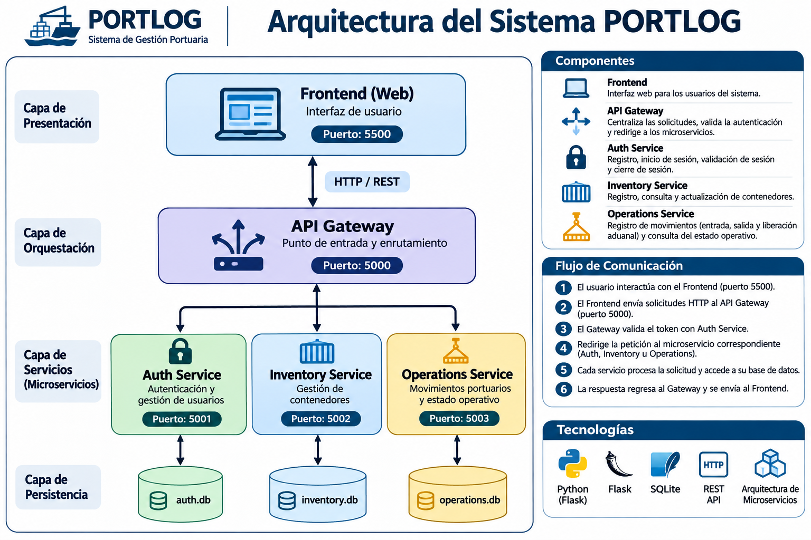

# PORTLOG

## Sistema de Gestión de Logística Portuaria

## 1. Descripción del proyecto

PORTLOG es un sistema web de gestión de logística portuaria desarrollado
mediante una arquitectura de microservicios. Permite administrar
contenedores y registrar operaciones como entradas, salidas y
liberaciones aduanales. Contempla dos roles: agente aduanal y
transportista, con permisos específicos.

## 2. Objetivo

Desarrollar una aplicación web para gestionar operaciones de logística
portuaria de forma organizada y segura, separando responsabilidades en
servicios independientes.

## 3. Tecnologías

-   Backend: Python y Flask.
-   Frontend: HTML, CSS y JavaScript.
-   Bases de datos: SQLite.
-   Comunicación: API REST mediante HTTP.
-   Arquitectura: microservicios.

## 4. Arquitectura

  Componente             Puerto Responsabilidad
  -------------------- -------- ---------------------------------------------
  Frontend                 5500 Interfaz web
  API Gateway              5000 Punto de entrada, validación y enrutamiento
  Auth Service             5001 Registro, autenticación y sesiones
  Inventory Service        5002 Administración de contenedores
  Operations Service       5003 Movimientos y estado operativo

Cada microservicio utiliza una base SQLite independiente: `auth.db`,
`inventory.db` y `operations.db`. El frontend se comunica con el
Gateway. Operations consulta Inventory mediante HTTP.

Diagrama: `docs/arquitectura_portlog.png`



## 5. Estructura del proyecto

``` text
PORTLOG/
├── api_gateway/
│   └── app.py
├── auth_service/
│   └── app.py
├── inventory_service/
│   └── app.py
├── operations_service/
│   └── app.py
├── database/
├── docs/
│   ├── API.md
│   ├── arquitectura_portlog.png
│   └── evidencias/
├── frontend/
│   ├── css/
│   ├── js/
│   └── index.html
├── requirements.txt
├── iniciar_portlog.sh
├── README.md
└── venv/  (solo entorno local; no subir a Git)
```

## 6. Funcionalidades

**Autenticación** - Registro e inicio/cierre de sesión. - Validación de
usuarios y sesiones mediante tokens.

**Inventario** - Consulta, registro, búsqueda y actualización de
contenedores.

**Operaciones** - Registro de entradas, salidas y liberaciones
aduanales. - Consulta del historial y del estado operativo.

**Seguridad** - Validación de tokens en el Gateway. - Autorización
basada en roles y validación también en el backend.

## 7. Roles y permisos

  Funcionalidad                      Agente aduanal   Transportista
  ---------------------------------- ---------------- ---------------
  Consultar contenedores             Sí               Sí
  Registrar contenedores             Sí               No
  Editar contenedores                Sí               No
  Consultar movimientos              Sí               Sí
  Registrar entradas y salidas       No               Sí
  Registrar liberaciones aduanales   Sí               No

## 8. Requisitos previos

-   Python 3.
-   pip.
-   Navegador web.
-   Terminal.
-   Visual Studio Code u otro editor (opcional).

Los comandos de esta guía están orientados a macOS/Linux. El entorno de
desarrollo utilizado durante las pruebas fue Python 3.12.5.

## 9. Instalación y configuración

### 9.1 Obtener el proyecto

Clona el repositorio o descarga el código fuente. Después entra a la
carpeta del proyecto:

``` bash
cd PORTLOG
```

### 9.2 Crear y activar el entorno virtual

Para una instalación nueva:

``` bash
python3 -m venv venv
source venv/bin/activate
```

Si el entorno ya existe:

``` bash
source venv/bin/activate
```

### 9.3 Instalar dependencias

``` bash
pip install -r requirements.txt
```

El archivo `requirements.txt` registra las dependencias principales:
Flask, requests, Flask-Cors y python-dotenv.

### 9.4 Bases de datos

PORTLOG utiliza tres bases de datos SQLite independientes:

-   `auth_service/data/auth.db`
-   `inventory_service/data/inventory.db`
-   `operations_service/data/operations.db`

Las carpetas `data/` se crean automáticamente al iniciar los
microservicios. Cada servicio ejecuta su función `inicializar_db()` y
crea sus tablas si todavía no existen. SQLite crea el archivo `.db` al
abrir la conexión.

Por lo tanto, los archivos de base de datos no necesitan incluirse en
GitHub para una instalación nueva. No publiques bases con información
personal, credenciales reales, tokens o datos privados; utiliza datos de
prueba.

### 9.5 Configuración

En el Gateway revisado, las direcciones de los servicios están definidas
en el diccionario `SERVICIOS`:

``` python
SERVICIOS = {
    "auth": "http://127.0.0.1:5001",
    "inventory": "http://127.0.0.1:5002",
    "operations": "http://127.0.0.1:5003"
}
```

En los fragmentos revisados no se identificaron variables de entorno
obligatorias para estas direcciones. Si se agregan variables o secretos
en otra versión, documenta sus nombres en `.env.example` y no publiques
el `.env` real.

## 10. Ejecución automática

Desde la carpeta principal del proyecto, concede permiso de ejecución al
script:

``` bash
chmod +x iniciar_portlog.sh
```

En la primera ejecución, el script crea el entorno virtual `venv` si no
existe, instala las dependencias de `requirements.txt`, crea las
carpetas `data/` y arranca los cinco componentes. También comprueba que
cada servicio responda antes de continuar.

Inicia PORTLOG con:

``` bash
./iniciar_portlog.sh
```

Abre en el navegador:

`http://127.0.0.1:5500`

Para detener el conjunto, presiona `Ctrl + C` en la terminal donde
ejecutaste el script. No lo ejecutes si ya hay procesos ocupando los
puertos 5000, 5001, 5002, 5003 o 5500.

**Requisito:** Python 3 debe estar instalado y disponible como
`python3`. La instalación de dependencias requiere conexión a Internet
en la primera ejecución.

## 11. Ejecución manual

Como alternativa, inicia cada componente en una terminal independiente
desde la raíz del proyecto, con el entorno virtual activado.

**Terminal 1 -- Auth**

``` bash
python auth_service/app.py
```

**Terminal 2 -- Inventory**

``` bash
python inventory_service/app.py
```

**Terminal 3 -- Operations**

``` bash
python operations_service/app.py
```

**Terminal 4 -- API Gateway**

``` bash
python api_gateway/app.py
```

**Terminal 5 -- Frontend**

``` bash
cd frontend
python -m http.server 5500
```

Abre `http://127.0.0.1:5500` y mantén las terminales abiertas mientras
utilizas el sistema.

## 12. Verificación

Gateway: `http://127.0.0.1:5000/health`

Rutas de salud a través del Gateway: - `/api/auth/health` -
`/api/inventory/health` - `/api/operations/health`

Las rutas de Inventory y Operations pasan por la validación de token del
Gateway en la implementación actual.

## 13. Documentación de API

La documentación de rutas, métodos, autenticación y respuestas se
encuentra en [`docs/API.md`](docs/API.md).

Rutas generales del Gateway: - `/api/auth/...` - `/api/inventory/...` -
`/api/operations/...`

Mantén `docs/API.md` sincronizado con las rutas reales del código.

## 14. Seguridad y pruebas

El Gateway valida los tokens consultando Auth y verifica los permisos
antes de reenviar solicitudes protegidas a Inventory u Operations.

Durante las pruebas se comprobó: - Inicio de sesión de agente aduanal y
transportista. - Consulta de contenedores y movimientos. - Registro de
liberación aduanal por el agente. - Registro de entradas y salidas por
el transportista. - Restricciones de registro y edición de contenedores
según el rol. - Rechazo de una liberación aduanal solicitada por un
transportista, con HTTP 403.

### 14.1 Registro inicial de usuarios e inicio de sesión

Cuando PORTLOG se instala por primera vez, las bases de datos y sus
tablas se crean automáticamente, pero la base de datos de autenticación
comienza sin usuarios. Para utilizar el sistema, primero se deben
registrar los usuarios de prueba.

El registro y el inicio de sesión se realizan mediante el API Gateway y
no requieren un token previo.

#### Registrar un usuario

**Método:** `POST`

**Endpoint:** `http://127.0.0.1:5000/api/auth/register`

En Postman, seleccionar **Body → raw → JSON** y enviar una solicitud
como la siguiente:

``` json
{
  "nombre": "Agente de Prueba",
  "correo": "agente@portlog.test",
  "password": "ClaveDePrueba123",
  "rol": "agente_aduanal"
}
```

Los cuatro campos son obligatorios:

-   `nombre`: nombre del usuario.
-   `correo`: correo electrónico con formato válido.
-   `password`: contraseña de al menos 8 caracteres.
-   `rol`: rol asignado al usuario.

Los roles admitidos por la implementación son:

-   `agente_aduanal`
-   `transportista`

Para registrar un transportista, se utiliza el mismo endpoint y se envía
`"rol": "transportista"`. Utiliza un correo diferente para cada usuario.

Si el registro es correcto, el servicio devuelve HTTP `201` y los datos
del usuario creado. Si faltan campos, el correo no tiene un formato
válido, la contraseña tiene menos de 8 caracteres o el rol no está
permitido, devuelve HTTP `400`. Si el correo ya está registrado,
devuelve HTTP `409`.

#### Iniciar sesión

Después de registrar el usuario, enviar:

**Método:** `POST`

**Endpoint:** `http://127.0.0.1:5000/api/auth/login`

En Postman, seleccionar **Body → raw → JSON**:

``` json
{
  "correo": "agente@portlog.test",
  "password": "ClaveDePrueba123"
}
```

Si las credenciales son correctas, el servicio devuelve HTTP `200`, un
mensaje de confirmación, los datos del usuario y un token de acceso. Si
el correo o la contraseña no son correctos, devuelve HTTP `401`.

#### Utilizar el token

Para realizar solicitudes protegidas a los servicios de inventario y
operaciones, incluir el token recibido al iniciar sesión en la cabecera
HTTP:

``` http
Authorization: Bearer TU_TOKEN
```

El token tiene una vigencia de 8 horas. Al expirar, el usuario debe
iniciar sesión nuevamente para obtener otro token.

**Consideración de seguridad:** en la implementación actual, el endpoint
de registro permite que quien lo invoque seleccione cualquiera de los
dos roles admitidos. Esto es adecuado para crear usuarios de prueba
durante la práctica, pero en un entorno de producción el registro y la
asignación de roles deben restringirse a personal autorizado. No
publiques contraseñas, tokens ni bases de datos que contengan
información privada.

## 15. Evidencias

Las capturas de las pruebas funcionales y de ejecución se encuentran en
`docs/evidencias/`:

1.  `01_health_gateway.png`
2.  `02_login_agente.png`
3.  `03_consultar_sesion_agente.png`
4.  `04_listar_contenedores.png`
5.  `05_registrar_contenedor.png`
6.  `06_actualizar_contenedor.png`
7.  `07_consultar_movimientos.png`
8.  `08_login_transportista.png`
9.  `09_entrada_transportista.png`
10. `10_salida_transportista.png`
11. `11_liberacion_aduanal.png`
12. `12_bloqueo_http_403.png`
13. `13_servicios_activos.png`

Las capturas de autenticación se prepararon ocultando contraseñas y
tokens. No publiques credenciales ni tokens reales.

## 16. Conclusión

PORTLOG demuestra una aplicación web basada en microservicios para la
gestión de logística portuaria. La separación de autenticación,
inventario y operaciones distribuye las responsabilidades, mientras que
el API Gateway centraliza las solicitudes y aplica controles de acceso
por roles. La aplicación integra una interfaz web, servicios REST
independientes y bases de datos SQLite separadas, además de
instrucciones de ejecución manual y automatizada para el entorno local.
